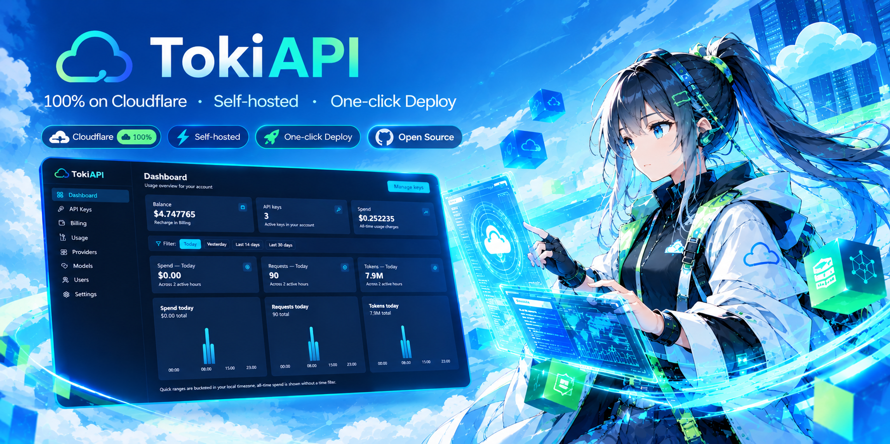

# TokiAPI



[](https://github.com/limccn/TokiAPI/actions/workflows/ci.yml)
[](LICENSE)

**中文 | [English](README.en.md)**

**自托管的 OpenAI 兼容 AI API 网关——一个入口代理多家模型供应商，100% 运行在 Cloudflare 上，无需任何外部服务。**

[](https://appflare.dev/install/?repo=limccn/TokiAPI) [](https://deploy.workers.cloudflare.com/?url=https://github.com/limccn/TokiAPI)

## 这是什么

把多家模型供应商（OpenAI 兼容接口与 Anthropic 原生格式）收敛成一个统一入口：你的应用照常用官方 SDK，只把 base URL 指向网关。网关负责用自己签发的 API Key 做鉴权、预付费按量计费、限流与缓存，并提供网页管理台看用量、管密钥、成员和模型价格。

## 能给谁用 / 能做什么

适合想统一管理多家模型供应商的个人与团队——尤其是把现有 OpenAI / Anthropic 应用迁到自托管入口、或需要给成员分发限额密钥并按量计费的场景：

- 一个入口多家模型（OpenAI 兼容 + Anthropic 原生格式）
- 应用侧几乎零改动：SDK 只换 base URL，换模型只改 `model` 参数
- 团队密钥：给每人发 key，可单独限速、随时吊销
- 预付费余额、按 token 计费，请求失败不扣费
- 自带限流与响应缓存：超额自动拒绝，重复请求更快更省
- 网页管理台：看用量报表，管密钥、成员与模型价格
- 数据与密钥留在自己的 Cloudflare 账号里（自托管）

## 快速开始

### 方式一：一键部署（推荐）

[](https://deploy.workers.cloudflare.com/?url=https://github.com/limccn/TokiAPI)

点击按钮，Cloudflare 会把仓库克隆到你的账号、按 `wrangler.jsonc` 自动供给 D1 / KV / Queues 资源（真实资源 id 回写到你的仓库副本），构建与发布由 Workers Builds 接管。secrets 与个性化值在 setup 页输入（即 `.dev.vars.example` 中列出的键）。

**前置条件**：

- Cloudflare 账号（**免费计划即可**——Queues 在 Free/Paid 均可用；Free 含每天 10,000 次队列操作额度，约 3,300 条计费消息，消息保留 24 小时。用量超出免费额度或需要更长保留期时再考虑 Paid）
- （可选）GitHub OAuth App：需要 GitHub 登录（也是**首个管理员的唯一入口**，见收尾清单）才需要；只用邮箱密码 + 邀请码可跳过

### 方式一·乙：Appflare 一键安装（第三方平台）

[](https://appflare.dev/install/?repo=limccn/TokiAPI)

[Appflare](https://appflare.dev) 是第三方 Cloudflare 自托管应用平台：把一个管理 Worker 装进你的 Cloudflare 账号后，即可从浏览器目录一键安装应用。安装时**自动供给资源、自动执行 D1 迁移、自动把站点 URL 填成实际地址**（无需收尾清单第 2 步）；本仓也已提交至其公共目录（收录后徽章会自动切到目录版）。仓库尚未被打包收录前，安装按「从仓库构建」进行——该形态**需要 Workers Paid**（构建跑在 Cloudflare Containers 里，免费计划不含），且需在你的 Appflare 设置里开启 Building。

### 方式二：手动部署

```bash
git clone <your-repo-url> tokiapi && cd tokiapi
npm install
cp .dev.vars.example .dev.vars   # 本地开发值（真实 secrets 本地值；部署用 secret put，见下节）
```

先创建真实资源并把 id 回填进 `wrangler.jsonc`（提交形态里的占位 id 仅用于本地开发，真实部署必须回填真实 id）：

```bash
npx wrangler d1 create cf-ai-gateway-db          # database_id → wrangler.jsonc
npx wrangler kv namespace create CACHE_KV        # id → wrangler.jsonc
npx wrangler queues create cf-ai-gateway-usage   # Queues 免费计划可用
npx wrangler queues create cf-ai-gateway-billing
```

然后一条命令构建 + 远程迁移 + 部署：

```bash
npm run deploy               # scripts/deploy.mjs：build → d1 migrations（remote）→ wrangler deploy
npm run deploy -- --dry-run  # 预览模式：只 build 并打印选中的配置与将执行的远程命令
```

配置选择规则（scripts/deploy.mjs）：仓库根存在 **`wrangler.prod.jsonc`**（维护者 fork：真实域名 routes + 真实资源 id + 个性化 vars；gitignored，不入库）就用它，否则用 **`wrangler.jsonc`**（按钮/开源形态）。维护者把自己的生产值放进 fork 文件后，`npm run deploy` 会自动选中——防呆语义：裸用按钮形态的占位 id 覆盖真实生产 worker 绑定的事故在结构上不可能发生。

## 部署后收尾清单（首个管理员与基本配置）

部署完成后系统是「零用户、策略开关全关」的安全态。按顺序做：

1. **数据库迁移**（一键部署必做；手动 `npm run deploy` 已自动包含）：
   ```bash
   npx wrangler d1 migrations apply DB --remote
   ```
2. **纠正站点 URL**：`wrangler.jsonc` 的 `BETTER_AUTH_URL` 缺省是 `http://localhost:5173`。一键部署在 Dashboard → Workers → 你的 Worker → Settings → Variables and Secrets 里改成实际 origin（如 `https://<worker>.<subdomain>.workers.dev`）；维护者 fork 直接改 `wrangler.prod.jsonc`。不改的后果：管理面请求被 301 到 `https://localhost/...`。
3. **写入 secrets**（按需四选四）：
   ```bash
   npx wrangler secret put BETTER_AUTH_SECRET     # 会话签名密钥（随机 ≥32 字符）
   npx wrangler secret put GATEWAY_SECRET_KEY     # 上游密钥加密密钥（随机 ≥32 字符，勿与上同）
   npx wrangler secret put GITHUB_CLIENT_SECRET   # 启用 GitHub 登录才需要
   npx wrangler secret put RESEND_API_KEY         # 启用邮箱验证/事务邮件才需要
   ```
4. **GitHub OAuth App**（首个管理员的唯一入口）：GitHub → Settings → Developer settings → OAuth Apps → New；回调地址精确等于 `https://<你的 origin>/api/auth/callback/github`。Client ID 替换配置里的 `replace-me-github-client-id`（一键部署改 Dashboard vars），Client Secret 用第 3 步写入；并把你的邮箱加进 `GITHUB_ALLOWED_EMAILS`（逗号分隔；**空 = 拒绝所有 GitHub 登录**）。
5. **首个管理员**：用白名单内 GitHub 账号登录后，把该账号提升为 admin（**唯一合法 bootstrap；禁止 SQL INSERT 造用户**——Better Auth 的哈希/绑定会被绕过）：
   ```bash
   npx wrangler d1 execute DB --remote \
     --command "UPDATE users SET role='admin' WHERE email='you@example.com';"
   ```
6. **生成邀请码**：管理员登录管理台 → 邀请页生成邀请链接，成员打开链接用邮箱密码注册。
7. **配置上游与价格**：管理台 → 供应商（填各家 API Key，AES-GCM 加密存储、响应中打码）；模型价格表在管理台逐条配置，或 `npx wrangler d1 execute DB --remote --file=./seed.sql` 灌默认价目（**全量替换**语义，已配过价格时慎用）。

## 配置在哪

| 形态 | 文件 | 用途 |
| --- | --- | --- |
| 提交入库 | `wrangler.jsonc` | 按钮/开源形态：资源绑定（占位 id，一键部署自动回写）+ `[vars]` 安全缺省 + 无自定义域名 routes |
| 本地值 | `.dev.vars`（gitignored，复制自 `.dev.vars.example`） | 真实 secrets 的本地值 + `[vars]` 本地覆盖（**只影响本地 dev**） |
| 维护者 fork | `wrangler.prod.jsonc`（gitignored，不入库） | 生产部署：真实域名 routes + 真实资源 id + 个性化 vars |

**真实 secrets**（**绝不写入任何配置文件或仓库**，用 `wrangler secret put` 逐个写入；一键部署在 setup 页输入）：

- `BETTER_AUTH_SECRET`、`GATEWAY_SECRET_KEY`——均必需（后者用于加密上游供应商密钥；各自随机生成，两者不得相同）
- `GITHUB_CLIENT_SECRET`——仅启用 GitHub 登录时需要
- `RESEND_API_KEY`——仅启用邮箱验证/事务邮件时需要

**`[vars]` 运行时值**（`wrangler.jsonc` 已带安全缺省；个性化值按收尾清单覆盖）：

| 键 | 缺省 | 说明 |
| --- | --- | --- |
| `BETTER_AUTH_URL` | `http://localhost:5173` | 平台域完整地址——**生产必须改为实际 origin**（缺省会使管理面 301 到 localhost） |
| `GITHUB_CLIENT_ID` / `GITHUB_ALLOWED_EMAILS` | 占位 / 空 | GitHub 登录（可选）；白名单空 = 拒绝所有登录（fail-closed） |
| `API_DOMAIN` | 空 | 双域名分流开关（空 = 关闭——单一 workers.dev 域的正确形态） |
| `API_KEY_PREFIX` / `REQUEST_LOG_RETENTION_DAYS` | `sk-` / `30` | 网关密钥前缀 / 请求日志保留天数 |
| `CACHE_ENABLED`、`EMAIL_VERIFICATION_ENABLED` 等策略开关 | 全部关闭 | 缺省即关闭（fail-closed），按需开启 |

各键的权威注释见 `wrangler.jsonc` 与 `.dev.vars.example`；运行时配置三分类的完整规则见 [CLAUDE.md](CLAUDE.md) §环境与配置。

## 接入示例

官方 SDK 只需换两处：base URL 指向网关，Key 用网关里创建的密钥：

```ts
import OpenAI from "openai";

const openai = new OpenAI({
  apiKey: "sk-…",                          // gateway API key
  baseURL: "https://<gateway>/v1",         // only this line changes
});

const completion = await openai.chat.completions.create({
  model: "gpt-…",                          // any model configured in the gateway
  messages: [{ role: "user", content: "hi" }],
});
```

```ts
import Anthropic from "@anthropic-ai/sdk";

const anthropic = new Anthropic({
  apiKey: "sk-…",                          // gateway API key
  baseURL: "https://<gateway>/anthropic",  // only this line changes
});

const message = await anthropic.messages.create({
  model: "claude-…",                       // any model configured in the gateway
  max_tokens: 1024,
  messages: [{ role: "user", content: "hi" }],
});
```

两种鉴权头（`Authorization: Bearer` 与 Anthropic 原生的 `x-api-key`）网关都接受。完整协议与端点见 [CLAUDE.md](CLAUDE.md)。

## 本地运行

**要求**：Node.js ≥ 20 和 npm；本地开发无需 Cloudflare 账号。

```bash
git clone <your-repo-url> tokiapi
cd tokiapi
npm install

# 1. 从提交入库的模板生成本地值文件（gitignored）
cp .dev.vars.example .dev.vars   # 至少填 BETTER_AUTH_SECRET / GATEWAY_SECRET_KEY

# 2. 准备本地数据库
npm run db:migrate     # 应用迁移
npm run db:seed        # 灌入默认模型价格表（幂等）

# 3. 启动 dev server
npm run dev            # http://localhost:5173
```

本地 dev 读取 `wrangler.jsonc`（绑定与 `[vars]` 安全缺省）+ `.dev.vars`（本地覆盖）。GitHub OAuth 是可选项，不配置也能跑；数据库命令用 binding 名引用（`DB`），配置文件显式 pin 到 `wrangler.jsonc`。

**第一个账号怎么来**：邮箱密码注册需要邀请码，而第一个管理员还没有发码入口——本地与线上同一条路径：GitHub OAuth。在 `.dev.vars` 配好 `GITHUB_CLIENT_ID` / `GITHUB_CLIENT_SECRET` / `GITHUB_ALLOWED_EMAILS`（你自己的邮箱），登录后把自己提升为管理员：

```bash
npx wrangler d1 execute DB --local --config wrangler.jsonc \
  --command "UPDATE users SET role='admin' WHERE email='you@example.com';"
```

管理员登录后即可在管理台生成邀请链接，成员打开链接用邮箱密码注册即可。

## 自部署与技术文档

- **部署要点**（维护者 fork、`--dry-run` 不校验资源就绪的坑、资源命名、回滚）→ [CLAUDE.md](CLAUDE.md) §部署要点
- **API 参考 / 常用命令 / 测试与验收 / 项目结构** → [CLAUDE.md](CLAUDE.md)

## 许可

MIT，见 [LICENSE](LICENSE)。
